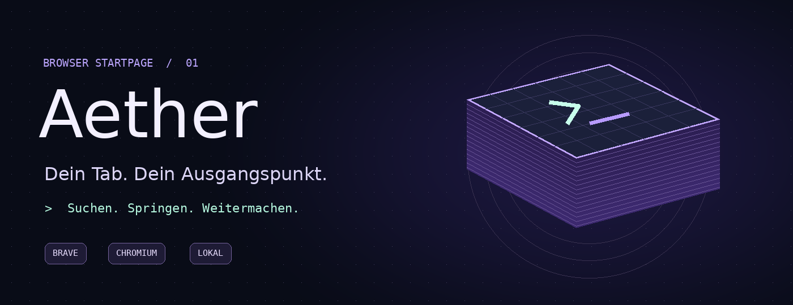
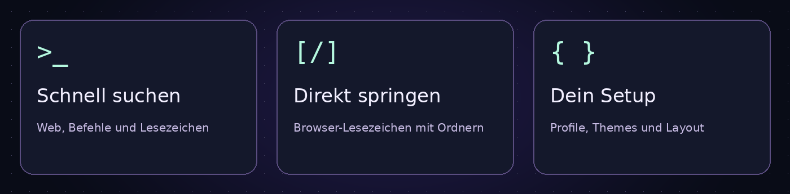

<div align="center">
  
  <h1>Aether</h1>
  <p>Eine tastaturfreundliche New-Tab-Erweiterung im Terminal-Look.</p>
  <p>
    
    
    
  </p>
  <p><a href="#installation">Installation</a> · <a href="#funktionen">Funktionen</a> · <a href="#entwicklung">Entwicklung</a></p>
</div>

## Überblick

Aether ersetzt den neuen Tab in Brave und Chromium. Statt erst durch Menüs zu klicken, kannst du direkt eine Websuche starten, einen Befehl finden oder zu einem Lesezeichen springen. Dazu gibt’s eine Uhr und ein Layout, das du selbst anpassen kannst.

## Funktionen



| Funktion | Was du damit machen kannst |
| --- | --- |
| Suche | Im Web suchen und Befehle oder Lesezeichen finden. |
| Browser-Lesezeichen | Auf deine vorhandenen Lesezeichen zugreifen – mit Ordnern und Favicons. |
| Personalisierung | Lokale Profile verwenden und Themes, Hintergründe und Layout anpassen. |
| Tastaturbedienung | Die Startseite per Tastatur bedienen und Animationen reduzieren. |
| Lokale Einstellungen | Aether speichert seine Einstellungen und Daten lokal im Browser. |

<!-- Sobald echte Screenshots vorliegen: hier eine Galerie mit neuem Tab, Suche und Einstellungen ergänzen. Die Grafiken oben sind Produktillustrationen. -->

## Installation

1. Lade das Repository als ZIP herunter oder klone es und entpacke gegebenenfalls das Archiv.
2. Öffne `brave://extensions` in Brave oder `chrome://extensions` in Chromium.
3. Aktiviere den Entwicklermodus.
4. Klicke auf **Entpackte Erweiterung laden** und wähle den Ordner mit `manifest.json`.
5. Öffne einen neuen Tab. Dort sollte jetzt Aether erscheinen.

## Entwicklung

Aether verwendet HTML, CSS und Vanilla JavaScript. Es gibt keinen Build-Schritt und keine externen Skripte in der Erweiterung.

```text
manifest.json  Erweiterungsmanifest
newtab.html    Startseite
settings.html  Einstellungsseite
css/           Styles
js/            JavaScript-Module
fonts/         Lokale Schriften
icons/         Erweiterungsicons
assets/        Grafiken und README-Medien
```

Zum lokalen Testen lädst du den Projektordner wie oben beschrieben als entpackte Erweiterung. Nach Codeänderungen kannst du die Erweiterung auf der Erweiterungsseite neu laden und den neuen Tab erneut öffnen.

## Feedback & Lizenz

Fehler oder Ideen kannst du als [Issue](../../issues) melden. Bei einem Fehler helfen Browser-Version, Schritte zum Nachstellen und das erwartete Verhalten. Die Lizenz findest du in [LICENSE](LICENSE).
